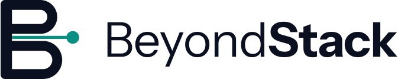

# BeyondStack Brand Guidelines v1.0

## 1. Design concept: the signal leaves the stack

BeyondStack is an engineering studio, so the mark is built like an engineering diagram. A letter **B** is assembled from a vertical stem and two bowls of different size. The bowls read as two layers of a stack. Between them runs a thin **signal line** that starts at the stem and ends in a **node** beyond the letter.

- **Beyond:** the signal exits the silhouette of the B.
- **Stack:** the B is made of layered, stacked parts.
- **Observe:** a line with a node is the visual shorthand of telemetry and monitoring.
- **Build, deploy, scale:** the larger lower bowl gives the letter weight and growth; the continuous line suggests a pipeline.

The marketing images enlarge the same idea: stacked bars on a rail, with teal signal lines passing through the slits between them and ending in nodes. The identity avoids gradients in logos, neon colors and decorative effects.


## 2. Symbol construction

Native grid: 64 × 64 units. The symbol occupies x 4 to 59.5 and y 4 to 60.

| Part | Specification |
| --- | --- |
| Stem | 8 units wide, 56 tall, corner radius 3 |
| Upper bowl | 7-unit stroke, radius 8.5, outer height 24 |
| Lower bowl | 7-unit stroke, radius 10, outer height 27 (larger than the upper) |
| Slit | 5 units tall between the bowls |
| Signal line | 2.2 units thick, from the stem to the node |
| Node | Circle, 4.5 radius (9 across), centered beyond the lower bowl |

A **small-size cut** (used for the favicon) has heavier strokes (8.5), a 6-unit slit, a 3-unit signal and a 5.5-radius node so the B and node survive at 16 px.

## 3. Color

| Name | Hex | Role | Contrast |
| --- | --- | --- | --- |
| Midnight Navy | `#0B1020` | Primary dark background; text on light | White on it 18.1:1 |
| Deep Slate | `#151C2E` | Panels and cards on dark | White on it 16.2:1 |
| Electric Teal | `#33D6C5` | The signal on dark surfaces | On Navy 10.4:1 |
| Signal Blue | `#6C8CFF` | Secondary accent, service icon lines | On Navy 6.2:1 |
| White | `#F8FAFC` | Primary light background; text on dark | Navy on it 18.1:1 |
| Muted Slate | `#94A3B8` | Secondary text on dark | On Navy 7.4:1 |

Companions added for light backgrounds, because Electric Teal (1.7:1 on white) and Signal Blue (2.9:1) are too light there:

| Name | Hex | Role | Contrast on White |
| --- | --- | --- | --- |
| Teal Ink | `#0B8F82` | Signal on light logos; graphics and large text only | 3.8:1 |
| Blue Ink | `#3F5FE0` | Links and accents on light surfaces | 5.1:1 |
| Mist | `#E2E8F0` | Borders and quiet light backgrounds | Navy on it 15.4:1 |
| Slate Ink | `#475569` | Secondary text on light | 7.2:1 |

Contrast uses WCAG 2 relative luminance. Gradients appear only in marketing backgrounds (a faint Signal Blue glow and a faint teal glow on Midnight Navy). No logo uses a gradient.

CSS custom properties are in `brand-tokens.css`.

## 4. Typography

- **Brand typeface: Instrument Sans** (SIL OFL 1.1), weights 400 and 700, for headings, interface text and the wordmark.
- **Code and technical values: JetBrains Mono** (SIL OFL 1.1).
- **Fallbacks:** `"Instrument Sans", "Segoe UI", system-ui, -apple-system, "Helvetica Neue", Arial, sans-serif` and `"JetBrains Mono", ui-monospace, "SF Mono", Menlo, Consolas, "Liberation Mono", monospace`.
- **Wordmark:** "Beyond" in Instrument Sans Regular, "Stack" in Instrument Sans Bold, tracking -0.4 at a 34-unit size, converted to outlines. Do not retype it; use the files.
- Suggested scale: display 48 to 76 / 700, heading 32 / 700, subheading 20 / 700, body 17 / 400 at 1.6 line height, caption 14 / 400.

## 5. Logo variants and recommended use

The suffix describes the background the file is designed for: `-dark` files have light artwork for dark backgrounds, `-light` files have dark artwork for light backgrounds.

| File | Use |
| --- | --- |
| `logos/beyondstack-logo-primary-dark.svg` / `-light.svg` | Default horizontal logo: website header, documents, email signatures |
| `logos/beyondstack-logo-stacked-dark.svg` / `-light.svg` | Square-ish spaces: covers, posters, footers |
| `logos/beyondstack-wordmark-dark.svg` / `-light.svg` | Where the symbol already appears nearby |
| `logos/beyondstack-logo-mono-white.svg` / `-mono-navy.svg` | One-color print, stamps, embossing, teal and blue backgrounds |
| `icons/beyondstack-symbol.svg` | Self-contained symbol tile for any background |
| `icons/beyondstack-symbol-dark.svg` / `-light.svg` | Transparent symbol on dark or light |
| `icons/beyondstack-symbol-teal.svg` | One-color teal, dark backgrounds only |

## 6. Clear space and minimum size


- **Clear space x = half the height of the symbol**, on every side. Nothing else enters this area.
- **Minimum sizes:** horizontal logo 120 px wide on screen (30 mm in print); stacked logo 96 px wide; wordmark 80 px wide; symbol 24 px, and 16 px using the small-size cut (`favicon.svg`).

## 7. Light and dark background rules

| Background | File |
| --- | --- |
| Midnight Navy, Deep Slate | `-dark` logo |
| White, Mist | `-light` logo |
| Electric Teal (10.4:1), Signal Blue (6.2:1) | `mono-navy` logo |
| Photos and patterns | `mono-white` or `mono-navy` on a calm, even area with at least 4.5:1 contrast |

White artwork on Electric Teal or Signal Blue fails contrast. Do not use it.

## 8. Incorrect usage

Do not:

- stretch, squash, rotate or skew the logo;
- recolor it outside the palette or swap the signal color;
- add shadows, glows, outlines or gradients;
- use a `-light` file on a dark background or a `-dark` file on a light one;
- place it on busy patterns or photos without a calm area behind it;
- rebuild the wordmark in another font or change the weight contrast between Beyond and Stack;
- separate the signal line from the symbol or redraw the node.

## 9. Website header and favicon

Header: `logos/beyondstack-logo-primary-dark.svg` on a dark header, or `-light.svg` on a light one, around 140 to 180 px wide on desktop and the symbol alone on narrow screens.

```html
<link rel="icon" href="/favicon.svg" type="image/svg+xml">
<link rel="icon" href="/favicon-32x32.png" sizes="32x32" type="image/png">
<link rel="icon" href="/favicon-16x16.png" sizes="16x16" type="image/png">
<link rel="apple-touch-icon" href="/apple-touch-icon.png">
```

For a web app manifest, list `icon-192.png` and `icon-512.png`. Both keep the symbol inside the 80 percent maskable safe zone.

## 10. GitHub, README files and social previews

- **GitHub organization or profile avatar:** `icons/beyondstack-avatar.png` (1024 × 1024).
- **README header (adapts to the reader's theme):**

```html
<picture>
  <source media="(prefers-color-scheme: dark)" srcset="logos/beyondstack-logo-primary-dark.svg">
  
</picture>
```

- **Repository social preview and link cards:** `social/og-image.png` (1200 × 630). GitHub recommends 1280 × 640; this image keeps its content centered so a small crop is safe.
- **X, LinkedIn and similar banners:** `social/social-banner.png` (1500 × 500). Profile pictures overlap the lower left on most networks, so important content stays in the center.
- **Presentations:** `social/brand-cover.png` (16:9).

## 11. Service icons

Six line icons on a 48-unit grid: 2.5 stroke, round caps and joins, 3-unit corner radius on containers, Signal Blue lines with one Electric Teal accent each. They read on dark surfaces and remain visible on light ones. On light backgrounds, replace the two hex values in the SVG (`#6C8CFF` with Blue Ink `#3F5FE0` and `#33D6C5` with Teal Ink `#0B8F82`) when you need stronger contrast.
