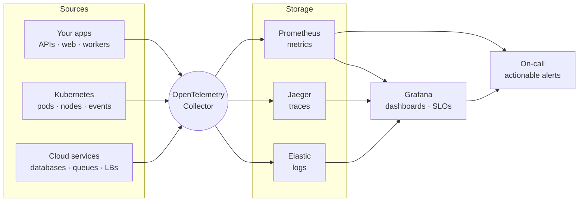

<picture>
  <source media="(prefers-color-scheme: dark)" srcset="https://raw.githubusercontent.com/Bey0ndStack/.github/master/profile/assets/logos/beyondstack-logo-primary-dark.svg">
  <source media="(prefers-color-scheme: light)" srcset="https://raw.githubusercontent.com/Bey0ndStack/.github/master/profile/assets/logos/beyondstack-logo-primary-light.svg">
  
</picture>

  

### Build. Deploy. Observe. Scale.

**Cloud infrastructure, DevOps, observability and full-stack engineering from one senior team.** 
We build your product, ship it to the cloud through automated pipelines and wire in observability from day one, 
so you release with confidence, grow without firefighting and always know what production is doing.

<!-- Add a website badge here once the site is live, for example:

-->

---

## About BeyondStack

BeyondStack is an engineering studio for teams who need their software to be **built well, shipped safely and understood in production**.

Most projects fail in the gaps between vendors: one team writes the code, another sets up the servers, and nobody owns the dashboards. We close those gaps. The same engineers who write your application also automate its delivery, run it on the cloud and instrument it, so every layer works together and every signal leads somewhere.

**We are a good fit if:**

- 🚀 you are launching a product and want a solid foundation without over-engineering;
- 🔁 your releases are manual, slow or stressful;
- 🔥 you hear about outages from your customers before your monitoring tells you;
- 💸 your cloud bill keeps growing and nobody is sure why;
- 🧠 only one person really knows how production works.

## What we do

<table align="center">
  <tr>
    <td align="center" width="260"> <b>Cloud infrastructure</b> Secure, reproducible platforms on AWS, Google Cloud or Azure, defined in Terraform and sized for the budget.</td>
    <td align="center" width="260"> <b>Observability</b> Metrics, logs and traces with OpenTelemetry, Grafana dashboards, SLOs and alerts that point to the cause.</td>
    <td align="center" width="260"> <b>DevOps and CI/CD</b> Pipelines with tests and security gates, GitOps delivery, canary releases and one-click rollback.</td>
  </tr>
  <tr>
    <td align="center" width="260"> <b>Full-stack development</b> Fast, accessible websites, portals and SaaS products with React and Next.js.</td>
    <td align="center" width="260"> <b>Backend and APIs</b> REST and event-driven services, integrations, queues and well-modelled data.</td>
    <td align="center" width="260"> <b>Performance and reliability</b> Load testing, autoscaling, high availability and incident reviews that harden the platform.</td>
  </tr>
</table>

## Observability first

If you can't see it, you can't fix it. Every system we ship comes with a complete signal pipeline, not as an upsell:

| Signal | What you get |
| --- | --- |
| **Metrics** | Latency, traffic, errors and saturation for every service |
| **Logs** | Structured, centralised and searchable in seconds |
| **Traces** | One request followed across every hop and database call |
| **Alerts and SLOs** | Pages based on user impact, each with a runbook |

## Technology stack

We choose tools for your team, budget and compliance needs, not for our résumés. These are the ones we use most in production.

<b>☁️ Cloud and infrastructure</b> 

<b>📦 Containers, orchestration and infrastructure as code</b> 
 

<b>🔁 CI/CD, GitOps and security</b> 
 

<b>🔭 Observability</b> 
 

<b>🖥️ Frontend</b> 

<b>⚙️ Backend</b> 

<b>🗄️ Data and messaging</b> 

## How we work

| Step | What happens | What you get |
| :---: | --- | --- |
| **01 · Discovery** | A free call about your product, goals and what is getting in the way | Honest first advice |
| **02 · Audit and plan** | We review your code, cloud and delivery, then decide what to fix first | Scope, timeline and cost in writing |
| **03 · Build and automate** | Short iterations with working results you can test along the way | Progress updates and demos |
| **04 · Launch and observe** | Safe rollout with dashboards and alerts live from the first day | A system you can see into |
| **05 · Scale and support** | Tune and harden with evidence from production, or hand over | Docs, runbooks and full ownership |

## Ways to work with us

| Engagement | Best for |
| --- | --- |
| **Launch:** build your product from idea to production, with CI/CD and monitoring included | Startups and new products |
| **Platform:** cloud and DevOps setup with infrastructure as code, containers, pipelines and environments | Teams with manual or risky deploys |
| **Observe:** an observability sprint covering instrumentation, dashboards, SLOs and alerting ⭐ | Teams who hear about issues from users |
| **Care:** ongoing reliability with monitoring, patches, cost reviews and steady improvements | Production apps that must stay up |

## What we stand for

- **Everything as code, all yours.** Infrastructure, pipelines and dashboards live in your repositories and accounts. No lock-in.
- **Observability by default.** Logs, metrics, traces and alerts ship with every system.
- **Security from the start.** Least-privilege access, managed secrets and scanning in every pipeline.
- **Clarity.** Systems, code and documentation a new engineer can understand in an afternoon.
- **Documented handover.** Architecture notes and runbooks so your team can run it without us.

## Open source

Public work lives in this organization. New repositories appear in the list below as they are published. ⭐ Star or watch the ones you find useful.

## Get in touch

Have a system to build, or one that keeps you up at night? Tell us what you are working on. **The first call is free.**

  

<picture>
  <source media="(prefers-color-scheme: dark)" srcset="https://raw.githubusercontent.com/Bey0ndStack/.github/master/profile/assets/icons/beyondstack-symbol-dark.svg">
  
</picture>

The signal leaves the stack.

